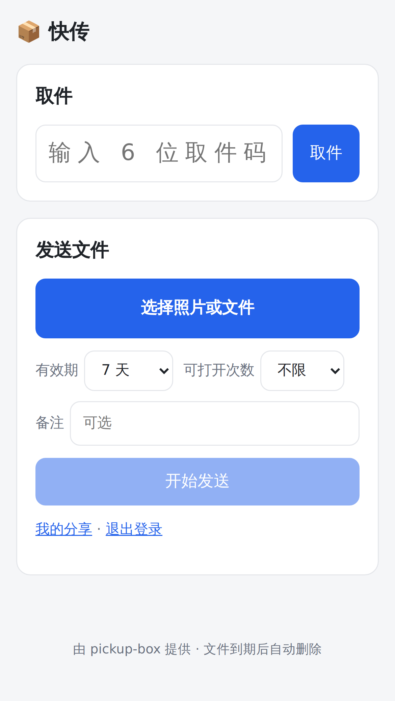
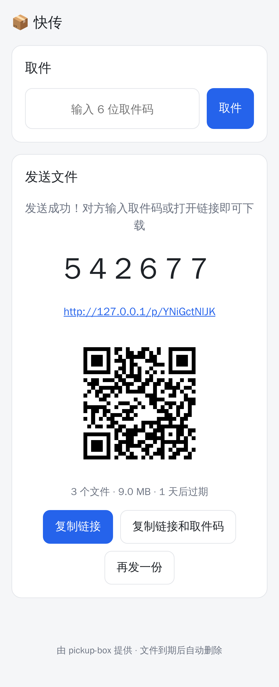
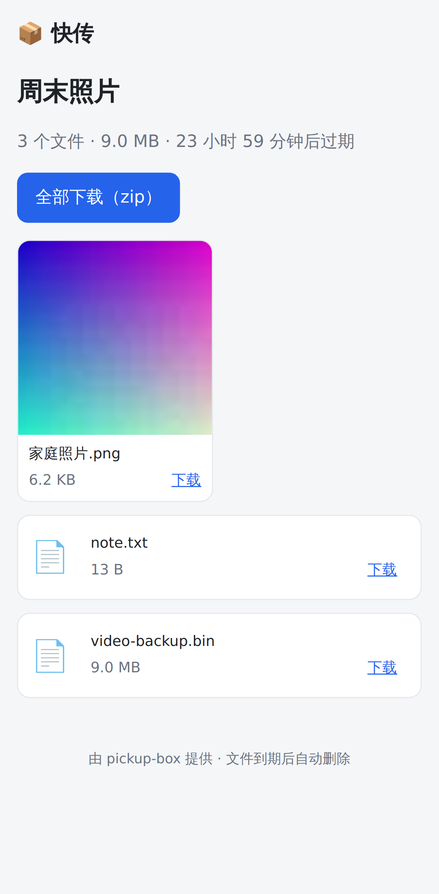

# pickup-box 快传

自己部署的**文件 / 照片快传**：在手机浏览器里选好照片、视频或任意文件发出去，得到一个**取件码**和**链接**（还有二维码）。对方不用注册、不用装 App，输入取件码或点开链接就能预览、下载，也能一键打包下载全部文件。分享到期后文件自动删除。

<p>



</p>

- **对普通人友好**：取件只需要 6 位数字取件码；取件页不依赖 JavaScript，老手机和微信内置浏览器都能用（微信里会提示“在浏览器打开”以便下载）。
- **不压缩原图原视频**：照片显示缩略图，视频和音频可以在线播放（支持拖动进度），文件按原样下载；也可以全部打包成 zip（不再压缩，速度快）。
- **大文件也稳**：上传支持断点续传，手机网络断了会自动从断点继续，单个文件默认上限 2 GB。
- **可控**：有效期（1 小时到 30 天）、可打开次数（比如只能打开 1 次）、随时撤回或延期。
- **安全**：上传要密码；取件码防暴力猜测；收到的网页、SVG 等文件一律作为附件下载、不会在浏览器里执行；链接预览机器人不会消耗“可打开次数”。

## 部署到公网服务器（3 步）

你需要：

1. 一台有公网 IP 的 Linux 服务器（1 核 1 GB 内存即可，x86 和 ARM 都支持），已安装 [Docker](https://docs.docker.com/engine/install/)。
2. 一个域名，添加一条 **A 记录**指向这台服务器（例如 `files.example.com`）。
3. 服务器防火墙 / 云安全组放行 **80** 和 **443** 端口。

然后在服务器上运行：

```bash
curl -fsSL https://raw.githubusercontent.com/Awrhs/pickup-box/main/deploy/install.sh | sh
```

脚本会询问你的域名，自动生成一个上传密码并启动服务（HTTPS 证书由 Caddy 自动申请和续期）。完成后打开 `https://你的域名`，用显示的密码登录即可发送文件。

### 服务器上已经有网站或代理（80/443 被占用）？

如果服务器上已经运行着 Caddy、nginx、宝塔面板或代理脚本，安装脚本会检测到端口被占用并停下，不会影响它们。此时改用“接入已有反向代理”模式：

```bash
curl -fsSL https://raw.githubusercontent.com/Awrhs/pickup-box/main/deploy/install.sh \
  | PICKUP_MODE=proxy PICKUP_DOMAIN=files.example.com sh
```

pickup-box 只监听本机 `127.0.0.1:18080`，并限制内存占用（默认 512 MB），不会抢占其他服务的资源。脚本会生成 `caddy-site.conf`（Caddy 站点文件）和 `nginx-site.conf`（nginx 配置片段），并打印下一步命令。例如服务器上的 Caddy 带有 `/etc/caddy/sites/` 目录时（很多一键脚本都是这样）：

```bash
sudo cp pickup-box/caddy-site.conf /etc/caddy/sites/files.example.com.conf
sudo systemctl restart caddy
```

<details>
<summary>不想用一键脚本？手动部署也只需要 2 个环境变量</summary>

```bash
mkdir pickup-box && cd pickup-box
curl -fsSLO https://raw.githubusercontent.com/Awrhs/pickup-box/main/deploy/docker-compose.yml
curl -fsSLO https://raw.githubusercontent.com/Awrhs/pickup-box/main/deploy/Caddyfile
cat > .env <<'EOF'
PICKUP_DOMAIN=files.example.com
PICKUP_PASSWORD=一个至少12位的密码
EOF
docker compose up -d
```

`PICKUP_DOMAIN` 留空则不启用 HTTPS，直接用 `http://服务器IP` 访问（适合先试一试）。
</details>

> 在中国大陆的服务器上使用域名需要先完成 ICP 备案；香港及海外服务器不需要。家里的宽带通常没有公网 IP、上行带宽也小，不太适合直接部署。

### 常见问题

- **打不开 / 证书错误**：先确认域名解析已生效（`ping 你的域名` 显示的是服务器 IP），并且云服务商的安全组放行了 80 和 443。Caddy 会自动重试申请证书，看进度用 `docker compose logs caddy`。
- **端口被占用**（`address already in use`）：服务器上已有别的网站程序（nginx、宝塔等）占用了 80/443，需要先停掉，或改为由它反向代理到本服务。
- **拉取镜像很慢或失败**（常见于中国大陆服务器）：在 `.env` 里改用镜像加速地址后重新 `docker compose up -d`：

  ```bash
  PICKUP_IMAGE=ghcr.nju.edu.cn/awrhs/pickup-box
  CADDY_IMAGE=docker.m.daocloud.io/library/caddy:2.8.4-alpine
  ```

  一键脚本也支持：`curl … | PICKUP_IMAGE=… CADDY_IMAGE=… sh`。
- **忘记上传密码**：在安装目录的 `.env` 里查看或修改 `PICKUP_PASSWORD`，然后 `docker compose up -d`。

## 配置

所有配置都在 `.env` 文件里，修改后运行 `docker compose up -d` 生效。

| 变量 | 默认值 | 说明 |
| --- | --- | --- |
| `PICKUP_DOMAIN` | （空） | 你的域名；留空则只提供 HTTP |
| `PICKUP_PASSWORD` | （必填） | 上传密码（管理员），至少 12 位 |
| `PICKUP_USERS` | | 额外的上传账号，如 `mom:密码1,dad:密码2`；每人只能管理自己的分享 |
| `PICKUP_SITE_NAME` | `快传` | 页面标题 |
| `PICKUP_MAX_FILE_SIZE` | `2G` | 单个文件上限 |
| `PICKUP_MAX_FILES` | `200` | 每个分享最多文件数 |
| `PICKUP_QUOTA` | `20G` | 非管理员账号每 30 天的上传额度（`0` 不限） |
| `PICKUP_MIN_FREE_PERCENT` | `10` | 磁盘剩余低于此百分比时拒绝新上传 |
| `PICKUP_DEFAULT_EXPIRY` / `PICKUP_MAX_EXPIRY` | `7d` / `30d` | 默认 / 最长有效期 |
| `PICKUP_CODE_LENGTH` | `6` | 取件码位数 |
| `PICKUP_VERSION` | `latest` | 使用的镜像版本 |

大小支持 `500M`、`2G` 这样的写法，时长支持 `30m`、`24h`、`7d`、`2w`。完整列表见 [.env.example](.env.example)。

## 使用

- **发送**：打开首页 →“发送文件”→ 输入上传密码（只需一次）→ 选择照片或文件 → 选择有效期和可打开次数 →“开始发送”。完成后把取件码或链接发给对方，也可以让对方扫二维码。
- **取件**：在首页输入取件码，或直接打开链接。
- **管理**：首页的“我的分享”可以复制链接、预览（不消耗次数）、延期、撤回。
- **命令行**：也可以用 `curl` 一步上传并分享，见 [docs/API.md](docs/API.md)。

## 运维

```bash
cd pickup-box
docker compose logs -f                          # 查看日志
docker compose pull && docker compose up -d     # 升级到最新版本
```

**备份**（文件本来就会过期，通常不需要；需要时）：

```bash
docker compose stop pickup-box
docker run --rm -v pickup-box_pickup-data:/data -v "$PWD":/backup alpine \
    tar czf /backup/pickup-backup.tgz -C /data .
docker compose start pickup-box
```

恢复时把 `tar czf` 换成 `tar xzf` 并解压回同一个数据卷。

## 原理与开发

基于 **OpenResty（Nginx + LuaJIT）**：上传用 tus 协议分块流式写盘；文件按 SHA-256 内容寻址存储、相同内容只存一份；缩略图由 **libvips（C）** 经 LuaJIT FFI 在线程池中生成；元数据存在 **SQLite**；zip 打包边读边发，不占用临时空间；二维码由 libqrencode 在服务端生成。

```bash
cp .env.example .env    # 设置 PICKUP_PASSWORD，PICKUP_DOMAIN 留空
docker compose up -d --build
python3 tools/e2e.py --base http://127.0.0.1 --password 你的密码
```

每次提交都会在 GitHub Actions 中运行：语法与静态检查、单元测试、端到端接口测试、真实浏览器（Playwright）测试、带 HTTPS 的生产部署测试，并在 x86 和 ARM 上验证发布的镜像。开发说明见 [CONTRIBUTING.md](CONTRIBUTING.md)，进度见 [PROGRESS.md](PROGRESS.md)。

## License

MIT
